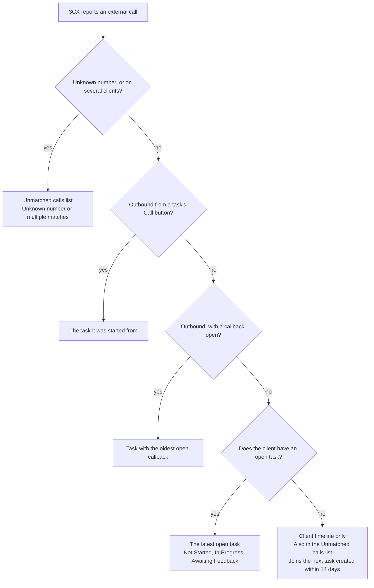
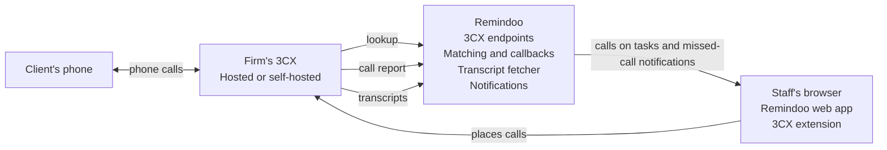
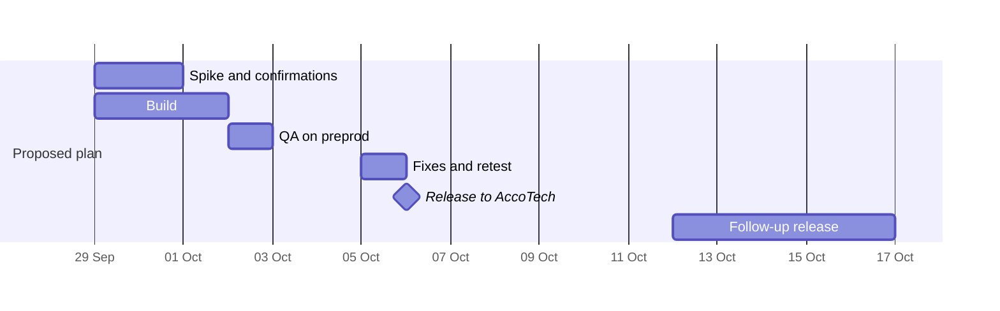

# PRD: 3CX Calling Integration for Remindoo Tasks

Sep 29, 2026 · @Suhaib

*Updated Oct 1, 2026: product-owner answers to To confirm items 5, 7, 8, 12 and 14; the CEO is AccoTech's 3CX admin.*

## Overview

Remindoo's task module will connect to 3CX, the phone system used for external calls, so every call with a client is recorded on the task it belongs to.

Any UK accounting firm on Remindoo can turn it on. The target production release is Oct 6, 2026. Each requirement has an ID and a release tag, so the build can be checked against this document line by line.

For each task, the integration keeps:

- Calls placed to the client through 3CX, with their call details.
- Calls from the client: when they called, whether and when someone got back to them, and who returned the call.
- A transcript of each call, stored in Remindoo where possible, or a link to the transcript held in 3CX as a fallback.

## Goals and non-goals

The first release, on Oct 6, 2026, puts every external 3CX call with a client on the right task and turns missed calls into tracked callbacks.

### Goals

- **G1** Every external call between staff and a client is logged in Remindoo and linked to a task, or to the client timeline when the client has no open task.
- **G2** A missed call from a client shows as "Callback due" on the task table and notifies the task's assignees. The task then records who called back and when.
- **G3** Each call record gives access to its transcript: stored in Remindoo where 3CX provides it, otherwise through a link to the call in 3CX.

### Non-goals for now

- Leads and lead tasks. Calls from lead numbers show as unknown numbers.
- Time tracking. Calls never create time entries or touch the task timer.
- AI summaries of calls.
- Searching transcripts.
- Internal calls between staff.
- Call dashboards in the first release. Their metrics are defined in Call metrics (tentative), so the data is captured from day one.

## Users and roles

Staff use the feature every day; admins set it up once per firm.

| Role | What they do with it |
| --- | --- |
| Staff | Call clients from tasks through the 3CX browser extension, read call history and transcripts, add call notes, move calls between tasks, and flag tasks "Reach out again". |
| Task assignees | Own the callbacks on their tasks. A task can have several assignees: all are notified of a missed call, and a callback by anyone clears it. |
| Firm admin | Turns the integration on, gives the firm's API key to their 3CX admin, and maps 3CX users to Remindoo users when emails differ. |
| Firm's 3CX admin | Installs Remindoo's template in 3CX and keeps call recording and AI transcription switched on. |

## User stories

Eight stories cover the first release; each names the requirement group that delivers it.

- **US-1** As a staff member, I click a client's number on a task, 3CX places the call, and the call is logged on that task. (FR-2)
- **US-2** As a task assignee, when a client calls and nobody answers, I'm notified and the task shows "Callback due". (FR-5)
- **US-3** As a task assignee, when anyone calls the client back, the task shows who called and when, and the callback clears. (FR-5)
- **US-4** As a staff member, I see every call with the client on the task: when, who, how long, the outcome, notes and the transcript. (FR-4)
- **US-5** As a staff member, I flag a task "Reach out again" so the team knows the client needs another call about it. (FR-5)
- **US-6** As a staff member, I move a call that landed on the wrong task to the right one. (FR-4)
- **US-7** As a staff member, when an unknown number calls, I see it marked as unknown, with a prompt to create a client and a button to copy the number. (FR-6)
- **US-8** As a firm admin, I turn the integration on and connect our 3CX to Remindoo. (FR-1)

## Functional requirements

Requirements marked [Must] make up the Oct 6, 2026 release. [Should] items ship then if they pass QA by Oct 5, 2026, otherwise in the follow-up release. [Later] items come after the pilot.

### Setup and connection

- **FR-1.1** [Must] A firm admin can turn the 3CX integration on or off in Settings. It is off by default for every firm.
- **FR-1.2** [Must] Turning it on generates a firm API key that 3CX uses to call Remindoo. Regenerating the key revokes the old one.
- **FR-1.3** [Must] Remindoo provides a 3CX CRM integration template with setup steps. The firm's 3CX admin installs it and enters the API key.
- **FR-1.4** [Must] Calls are attributed to Remindoo users by matching the 3CX user's email to their Remindoo login email.
- **FR-1.5** [Should] Admins can map a 3CX extension to a Remindoo user by hand. Until then, its calls show the 3CX name and extension.
- **FR-1.6** [Should] Settings show connection health: when the last call arrived from 3CX, and recent errors.
- **FR-1.7** [Should] If transcripts need 3CX's API (To confirm #3), admins enter the 3CX address and API credentials in Settings.

### Calling from a task

- **FR-2.1** [Must] Client phone numbers on tasks and client records are tel: links, so the 3CX browser extension places the call.
- **FR-2.2** [Should] Clicking a number on a task records a call intent: the task, user, number and time.
- **FR-2.3** [Should] An outbound call from the same user to the same number, starting within 2 minutes of the intent, links to the intent's task.

### Logging and matching calls

- **FR-3.1** [Must] Remindoo accepts 3CX's report of every external call: inbound answered, inbound missed (including voicemail), outbound answered and outbound not answered.
- **FR-3.2** [Must] Internal calls between staff are ignored.
- **FR-3.3** [Must] A call reported twice is stored once. Deduplicate on 3CX's call ID, or on number, agent and start time if there is no ID.
- **FR-3.4** [Must] Numbers are normalised to E.164 before matching. A number without a country code is treated as UK (+44).
- **FR-3.5** [Must] The number is matched against every number in every client's phone list within the firm.
- **FR-3.6** [Must] Each call links to a task, the client timeline or the Unmatched calls list, following Call-to-task association rules.
- **FR-3.7** [Must] A transferred call appears once, listing everyone who handled it (To confirm #2).
- **FR-3.8** [Should] When a call starts, 3CX can look up the caller. Remindoo returns the client's name and a link to their record.

### Calls on the task and client

- **FR-4.1** [Must] Each task has a Calls list, newest first. Each call shows direction, outcome, date and time, duration, who handled it, the client's number, notes, and its transcript or 3CX link.
- **FR-4.2** [Must] Every call matched to a client also appears on that client's timeline, whether or not it is linked to a task.
- **FR-4.3** [Must] Anyone who can see a call can add a note to it. Notes show their author and time, and authors can edit their own.
- **FR-4.4** [Should] Staff can move a call to another of the client's tasks, or unlink it to the client timeline. Remindoo records who moved it and when.
- **FR-4.5** [Should] Where 3CX provides a transcript, Remindoo stores the text and shows it on the call, collapsed by default.
- **FR-4.6** [Must] Without a stored transcript, the call links to its recording in 3CX. The link opens only for staff whose 3CX role lets them see that recording (To confirm #10).
- **FR-4.7** [Later] Remindoo transcribes recordings itself for firms without 3CX AI transcription.

### Missed calls and callbacks

- **FR-5.1** [Must] A missed inbound call from a client, linked to a task, opens a callback on that task.
- **FR-5.2** [Must] All of the task's assignees get an in-app notification when the missed call is logged.
- **FR-5.3** [Must] A callback is due by 17:30 on the same working day as the missed call. A call missed after 17:30, or on a non-working day, is due by 17:30 on the next working day (decided Oct 1, 2026; the after-hours rule is assumed). Unresolved by then, it shows as overdue.
- **FR-5.4** [Must] The first outbound attempt linked to the task after the missed call resolves the callback, answered or not. Remindoo records who called, when, and whether it was within target.
- **FR-5.5** [Must] Further missed calls while a callback is open are logged but open no new callback. The due time stays with the first missed call.
- **FR-5.6** [Should] An answered inbound call from the client also resolves an open missed-call callback on its task.
- **FR-5.7** [Must] The task table shows each task's callback state: "Callback due" with the due time, or "Overdue".
- **FR-5.8** [Should] The task table can be filtered to tasks with a callback due or overdue.
- **FR-5.9** [Must] Staff can flag a task "Reach out again", with an optional note and due time (default: 17:30 the same working day). It shows on the task table like a callback.
- **FR-5.10** [Must] A "Reach out again" flag resolves like a callback, through an outbound attempt linked to that task. Staff can also clear it by hand.
- **FR-5.11** [Later] Firms set their own callback target and working hours.

### Unknown numbers and unlinked calls

- **FR-6.1** [Must] A call from a number on no client is stored as "Unknown number".
- **FR-6.2** [Must] An Unmatched calls list shows unknown-number calls and client calls with no task, newest first. A client's calls there are shown to, and missed ones notify, the service managers and assignees on that client's services (decided Oct 1, 2026). Unknown-number calls go to firm admins (assumed).
- **FR-6.3** [Must] Each unknown-number call shows a line suggesting a new client, with a Copy number button that copies the number to the clipboard.
- **FR-6.4** [Must] A number on more than one client is stored as "Multiple matches", listed with those clients and never linked automatically.
- **FR-6.5** [Should] When a task is created for a client, their calls from the previous 14 days with no task link to it. A missed call among them opens a callback on the new task, keeping its original due time, and notifies the assignees.
- **FR-6.6** [Later] Adding a number to a client re-matches earlier unknown calls from that number.

### Reporting

- **FR-7.1** [Later] Call dashboards show the metrics in Call metrics (tentative).

## Call-to-task association rules

A client's call goes to their latest open task; with no open task it stays on the client timeline, and unknown numbers go to the Unmatched calls list.

*Each call lands on a task, the client timeline or the Unmatched calls list. Checks run top to bottom; inbound calls answer no to both outbound checks.*

Staff can move any call afterwards (FR-4.4).

The checks run in this order, and the first match wins:

1. Unknown number, or a number on several clients: the Unmatched calls list.
2. Outbound call started from a task's Call button: that task.
3. Outbound call while the client has an open callback: the task with the oldest open callback.
4. The client has an open task: the latest open task.
5. Otherwise: the client timeline and the Unmatched calls list. The call joins the next task created for the client within 14 days.

### Definitions

- **Open task**: a task for the client with status Not Started, In Progress or Awaiting Feedback.
- **Latest**: the open task created most recently (confirmed Oct 1, 2026).
- **Working hours**: Monday to Friday, 09:00 to 17:30 UK time. A callback is due by 17:30 on the working day of the missed call; one missed after 17:30 or on a non-working day is due by 17:30 on the next working day (assumed). UK bank holidays are not excluded in the first release.

### Callbacks

- A missed inbound call on a task opens a callback and notifies all of the task's assignees.
- Any outbound attempt linked to that task afterwards resolves the callback, answered or not.
- Staff call out on their own direct line (decided Oct 1, 2026), so a client returning a call usually rings that person's extension.
- Moving a call re-checks both tasks: a callback it resolved on the old task reopens, and it resolves an older open callback on the new task.

The latest-task rule can't tell which service a call is about, so a call can land on another service's task. Staff move it, and the rule is revisited after the pilot (To confirm #15).

## Data model

The feature adds call and callback records, plus call notes, call intents, a move history and per-firm 3CX settings. Every record also has an id and created and updated times.

### Call

| Field | Type | Notes |
| --- | --- | --- |
| `firm_id` | reference | Every read and write is scoped to one firm. |
| `external_call_id` | text, optional | 3CX's call ID, for deduplication. |
| `direction` | inbound, outbound | |
| `outcome` | answered, missed, not answered | Missed: inbound and unanswered, including voicemail. Not answered: an outbound attempt the client didn't pick up. |
| `number_raw` | text | As 3CX sent it. |
| `number` | text | E.164, used for matching. |
| `started_at` | timestamp, UTC | Shown in UK time. |
| `duration_seconds` | integer | Talk time; 0 when missed. |
| `handled_by` | list of users | Everyone who handled the call, in order. |
| `threecx_agents` | list | 3CX name, extension and email, kept when no user is mapped. |
| `queue` | text, optional | Queue or ring group, if 3CX sends it. |
| `match_status` | matched, unknown, multiple | |
| `client_id` | reference, optional | Empty when unknown or multiple. |
| `candidate_client_ids` | list, optional | Filled for multiple matches. |
| `task_id` | reference, optional | Empty when the call is on the client timeline only. |
| `link_method` | call button, rule, new task, manual | How the call got its task. |
| `recording_url` | text, optional | Link into 3CX. |
| `transcript_text` | text, optional | Stored in Remindoo and kept indefinitely. |
| `transcript_status` | pending, stored, unavailable | |

### Callback

| Field | Type | Notes |
| --- | --- | --- |
| `task_id` | reference | |
| `client_id` | reference | |
| `reason` | missed call, reach out again | |
| `opened_by_call_id` | reference, optional | The first missed call. |
| `opened_by_user_id` | reference, optional | Who set a Reach out again flag. |
| `note` | text, optional | The flag's note. |
| `missed_call_count` | integer | Missed calls from the client while it was open. |
| `opened_at`, `due_at` | timestamp | |
| `status` | open, resolved, cleared | Cleared: removed by hand. |
| `resolved_by_call_id` | reference, optional | |
| `resolved_by_user_id` | reference, optional | Who called back. |
| `resolved_at` | timestamp, optional | |
| `within_target` | boolean, optional | |

### Other records

- **Call note**: call, author, text, and when it was written and edited.
- **Call intent**: firm, task, user, number, click time and matched call. Unmatched intents expire after 2 minutes.
- **Call move**: call, from task, to task, user and time.
- **Firm 3CX settings**: on or off, hashed API key and when it was issued, 3CX address, encrypted API credentials, last call received and last error.
- **3CX user map**: 3CX extension and email, mapped to a Remindoo user.

The task table shows each task's earliest open callback.

## Integration architecture

3CX pushes every call to Remindoo through its CRM integration, and Remindoo fetches each transcript from 3CX where the firm's edition allows.

*3CX sends every call to Remindoo, and Remindoo fetches each transcript.*

Arrows show which way information moves; Remindoo requests the transcripts itself.

- **3CX CRM integration**: a template Remindoo provides and the firm's 3CX admin installs. 3CX calls Remindoo over HTTPS with the firm's API key: a lookup when a call starts, and a call report when it ends.
- **3CX API**: used by the transcript fetcher when the call report doesn't carry the transcript or recording link. Whether AccoTech's version and edition allow this is To confirm #1 to #3.
- **3CX browser extension**: staff already use it to call. It dials the tel: links on Remindoo pages, which is all calling from a task needs.
- **Background processing**: the call-report endpoint stores each report and replies at once. Matching, callbacks and notifications run in a background job with retries.

## Permissions, privacy and compliance

Call records inherit task access: anyone who can see a task sees its calls, notes and transcripts, and no one else does.

- The tasks-module permissions list isn't final. Call records follow it once it is (To confirm #13).
- Calls on the client timeline follow the client record's access.
- The Unmatched calls list shows each client's calls to the service managers and assignees on that client's services, who are also notified of that client's missed calls (decided Oct 1, 2026). Unknown-number calls are shown to firm admins (assumed).
- Anyone who can see a call can add a note; only its author can edit it.
- Transcripts are kept indefinitely in the first release, and nothing is deleted automatically.
- UK GDPR expects a defined retention period, so "as long as possible" needs to become a set period before other firms go live (To confirm #16).
- Recording audio stays in 3CX. How long it lasts depends on each firm's 3CX recording settings; if 3CX deletes a recording, its link stops working.
- Callers should be told calls are recorded, usually by a 3CX announcement. Each firm confirms it has one.
- Transcription runs in 3CX under the firm's own settings. Remindoo stores only the resulting text.
- API keys are stored hashed, 3CX API credentials are encrypted, and every call record belongs to exactly one firm.

## Non-functional requirements

No call report from 3CX is lost, and every call shows on its task within a minute.

- **NFR-1** Remindoo stores each 3CX call report before replying, then processes it in the background, retrying until it succeeds.
- **NFR-2** A call appears on its task, and missed-call notifications go out, within 60 seconds of 3CX sending the report.
- **NFR-3** The caller lookup answers within 1 second, so 3CX can show the caller's name while the phone rings.
- **NFR-4** Transcripts are fetched as soon as 3CX has them, retrying for up to 24 hours before being marked unavailable.
- **NFR-5** Timestamps are stored in UTC and shown in UK time. Working hours follow UK time across GMT and BST changes.
- **NFR-6** Sized for up to 500 external calls a day per firm, an assumption to confirm (To confirm #17).
- **NFR-7** Every 3CX request and processing error is logged per firm, and the latest show in Settings.
- **NFR-8** Call moves and cleared callbacks are recorded with who and when.

## Call metrics (tentative)

Every metric below uses data the first release captures; the dashboards come after the pilot. All of them filter by date range.

| Metric | How it's calculated | Break down by |
| --- | --- | --- |
| Client calls received | Inbound calls matched to a client | Answered or missed, day |
| Missed call rate | Missed inbound client calls ÷ all inbound client calls | Day, hour of day |
| Open callbacks | Open callbacks, including Reach out again flags | Due or overdue, assignee |
| Callbacks on time | Callbacks resolved within target ÷ all resolved callbacks | Assignee, reason |
| Median time to call back | Working hours from a missed call to the first outbound attempt | Assignee |
| Repeat calls before callback | Callbacks where the client called again before anyone called back | Client |
| Outbound calls to clients | Outbound calls matched to a client | Answered or not, staff member |
| Calls per staff member | Answered inbound and outbound calls each person handled, with their talk time | Direction |
| Average talk time | Mean duration of answered calls | Inbound or outbound |
| Calls per client | Calls matched to each client | Top 20 clients |
| Calls per task | Calls linked to each task | Top 20 tasks, task status |
| Unknown-number calls | Calls from numbers on no client | Answered or missed |
| Calls with no open task | Client calls kept on the timeline because no task was open | Client |
| Transcript coverage | Calls with a stored transcript ÷ recorded calls | Month |

## Success metrics

The AccoTech pilot succeeds if calls land in the right place without manual fixes.

- At least 90% of calls from known client numbers link to a task or the client timeline with no manual move.
- Every external call in 3CX's call history during the pilot also appears in Remindoo, checked weekly.
- Once transcript storage ships, at least 95% of AccoTech's recorded calls have a transcript in Remindoo within 24 hours.
- Callbacks on time is measured from the first week, to set a baseline and then a target.

## Rollout and milestones

Proposed: ship the Must items to AccoTech alone on Oct 6, 2026, behind the per-firm switch, and open the feature to other firms after the pilot.

*Build, QA and retest have five working days before the 6 October release (proposed plan, 2026).*

The plan leaves one day for QA and one for fixes and retest.

- AccoTech goes first because it is the only firm with 3CX AI transcription confirmed.
- Should items ship on 6 October only if they pass QA by 5 October; otherwise they go in the follow-up release, proposed for 12 to 16 October.
- QA runs on preprod against a 3CX system that can send calls there (To confirm #6).
- Release needs a QA pass on every call type: inbound answered, missed, voicemail, outbound answered, not answered and transferred, plus an unknown number and a number on two clients.
- Other firms go live once permissions (#13) and retention (#16) are settled. Without 3CX AI transcription, they get 3CX links instead of stored transcripts until FR-4.7 ships.

## Open questions and risks

Seventeen items were open on Sep 29. On Oct 1, 2026 the product owner answered items 5, 8, 12 and 14 and part of 7, and named the CEO as AccoTech's 3CX admin. Items 1 to 4 block the build and were due Sep 30; item 6 is needed before QA on Oct 2.

### To confirm

| # | To confirm | Why it matters | Who | Needed by | Status |
| --- | --- | --- | --- | --- | --- |
| 1 | AccoTech's 3CX version and edition, and whether 3CX hosts it or it's self-hosted | Decides whether Remindoo can use 3CX's API for transcripts and recordings | CEO (AccoTech's 3CX admin) | Sep 30, 2026 | Open |
| 2 | What 3CX's call report contains: call ID, missed or answered, agent email, queue, transfers and recording link | Drives deduplication, matching, callbacks and who called back | Zain (spike) | Sep 30, 2026 | Open |
| 3 | How Remindoo gets transcript text from 3CX, and how soon after a call it is ready | Decides whether transcripts are stored or linked on 6 October | Zain (spike) | Sep 30, 2026 | Open |
| 4 | Whether the 3CX browser extension dials tel: links on Remindoo pages | Calling from a task | Zain (spike) | Sep 30, 2026 | Open |
| 5 | That "latest task" means the open task created most recently | Which task a call lands on | Product owner | Sep 30, 2026 | Answered Oct 1: yes, the open task created most recently |
| 6 | A 3CX system that can send calls to preprod for testing | QA on 2 October | Zain and the CEO (3CX admin) | Oct 1, 2026 | Open; needed before QA on Oct 2 |
| 7 | Whether clients call one common firm number, and how it's routed: menu, queue, ring group or direct lines | Who a missed call belongs to, and whether 3CX reports one missed call or one per person it rang | Product owner and the CEO (3CX admin) | Oct 1, 2026 | Partly answered Oct 1: one base number on AccoTech's 3CX account, plus an extension for every user. Base-number routing is with the CEO; suggested: an automated attendant (AI or standard) or a reception |
| 8 | The set number staff call out on, and whether it's the common firm number | The number clients see and call back on | Product owner | Oct 1, 2026 | Answered Oct 1: each person's direct line, not the common number |
| 9 | Whether the landlines staff use run through 3CX | Landline calls outside 3CX never reach Remindoo | CEO (3CX admin) | Oct 1, 2026 | Open; product owner unsure, passed to the CEO |
| 10 | Whether staff can open colleagues' recordings in 3CX | Decides whether 3CX links work for everyone on a task | CEO (3CX admin) | Oct 1, 2026 | Open |
| 11 | Whether 3CX user emails match Remindoo login emails | Crediting calls to the right person | CEO (3CX admin) | Oct 1, 2026 | Open |
| 12 | A callback target of 4 working hours, Monday to Friday, 09:00 to 17:30 | When callbacks turn overdue | Product owner | Oct 1, 2026 | Answered Oct 1: due by 17:30 the same working day, replacing 4 working hours |
| 13 | The tasks-module permissions list | Call visibility follows it | Product owner | Oct 2, 2026 | Open |
| 14 | Who sees the Unmatched calls list, and who hears about missed calls from clients with no open task | These calls have no assignees to notify | Product owner | Oct 2, 2026 | Answered Oct 1: the service managers and assignees on that client's services |
| 15 | How a call gets tied to the right service when a client has tasks for several | The latest-task rule can pick another service's task | Product owner | After the pilot | Open |
| 16 | A retention period for recordings and transcripts, and recording notices for callers | UK GDPR expects a set period, and callers told they are recorded | Data protection lead | Before other firms go live | Open |
| 17 | Expected external calls per day per firm | Sizing | Product owner | After the pilot | Open |

### Risks

| Risk | Effect | Mitigation |
| --- | --- | --- |
| Five working days to build, test, fix and retest, with the 3CX version unknown and no build started | The release slips or ships with defects | Ship Must items only, to AccoTech alone; answer items 1 to 5 by 30 September |
| AccoTech's 3CX edition doesn't give API access to transcripts | Transcripts are linked, not stored, at launch | Link to 3CX, which is acceptable; Remindoo transcription later (FR-4.7) |
| The latest-task rule picks another service's task | Calls sit on the wrong task | Staff move the call (FR-4.4); revisit the rule after the pilot (item 15) |
| Client numbers stored in mixed formats or shared between clients | Calls land as unknown or multiple matches | E.164 normalisation and the Unmatched calls list |
| A firm's 3CX already runs another CRM integration | 3CX may not run two at once | Check each firm's 3CX before switching the feature on |
| 3CX deletes old recordings | Recording links stop working | Firms set 3CX to keep recordings; copying audio into Remindoo is an option later |
| Retention "as long as possible" | Conflicts with UK GDPR's storage limitation principle | Set a period before other firms go live (item 16) |
